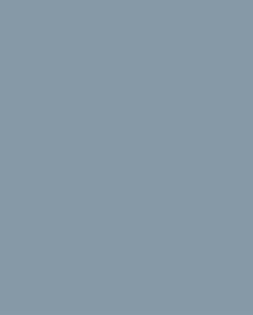
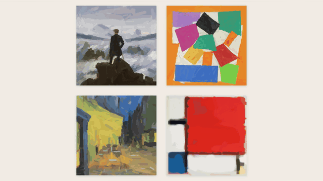

# Paintcrastinator

**Paint famous pictures one stroke at a time** — from a two-minute warm-up to a five-hour masterpiece. The most productive way to not do your work.

<p align="center">
  
</p>

**Try it:** <https://paint.otaliptus.com>

Every painting is a *recipe*: an ordered list of soft brush strokes, each with a path, a colour, a size and an opacity. You can **watch** the recipe paint itself, or **paint it yourself**: the app shows you where the next stroke goes and gives you its colour and brush, and you make the gesture.

<p align="center">
  
</p>

## What's inside

26 paintings, sorted by how long they take to paint (about 4 seconds per stroke):

| Section | Strokes | Paintings |
|---|---:|---|
| Warm-ups | 20–31 | Two short lessons: a sunset sky and hills fading into the distance |
| 15 minutes | 225 | Whistler's *Nocturne*, Monet's *Impression, Sunrise* |
| 30 minutes | 450 | Mondrian's *Composition with Red, Blue and Yellow* |
| 1 hour | 600–900 | *Whistler's Mother*, *American Gothic*, Cézanne's *The Basket of Apples*, Hiroshige's *Sudden Shower* |
| 2–3 hours | 1,800–2,800 | *Wanderer above the Sea of Fog*, *The Snail*, *Woman with a Parasol*, *Almond Blossom*, *Café Terrace at Night*, *The Fighting Temeraire*, *The Kiss* |
| Masterpieces · 5 hours | 5,000 | *Mona Lisa*, *Girl with a Pearl Earring*, *The Starry Night*, *The Great Wave*, *The Scream*, *Sunflowers*, Van Gogh's *Self-Portrait*, Marilyn Monroe, the Blue Marble, a Lamborghini Countach |

## Painting in the app

- **Watch** plays the recipe from a blank canvas. You can pause, change the speed, scrub, or jump to any of the four stages: *Blocking in*, *Form and color*, *Refinement*, *Fine details*.
- **Paint** shows the next stroke as a shaded band with a dot where it starts. Drag over it in one go; the colour and brush size are chosen for you.
  - **Zoom** enlarges the view when a stroke is small, so fine details are easy to hit.
  - **Steady hand** pulls your stroke onto the guide, so a shaky mouse or finger still lands where it should.
  - **Undo**, **Skip stage** and **Restart** are always there, and short recipes show a one-line tip for each stage.
  - **Your progress is saved** in your browser for each painting, so you can close the tab and continue later.
- **♪ Music** in the header plays a soft lo-fi loop in the background while you paint. It is off by default, and the site remembers your choice.

## How it works

- **One brush for everything.** [`app/brush.js`](app/brush.js) paints a stroke by stamping a soft round brush along its path. The app and the offline renderer use this same file. The planner uses a NumPy model of the same brush, and every recipe is re-rendered with the real brush before it is scored, so what you see in the browser is what was measured.
- **Recipes** live in [`recipes/`](recipes) as JSON. A stroke is `{"p": [x0, y0, x1, y1, …], "c": "#rrggbb", "s": size, "o": opacity}` in the painting's own pixel space, grouped into four stages.
- **The planner** ([`tools/greedy/greedy_planner.py`](tools/greedy/greedy_planner.py)) builds a recipe for a given stroke budget, stage by stage from big strokes to small ones:
  1. It looks where the painting so far differs most from the original.
  2. It tries many candidate strokes there: following the direction of the forms, straight, or at a free angle.
  3. For each candidate it solves for the single colour that best fixes what is underneath (a least-squares fit, not an average).
  4. It keeps the best candidate, nudges its position, size, length and angle to improve it further, and paints it.

  Stroke sizes scale with the budget, so a 225-stroke recipe uses big, broad marks and a 5,000-stroke recipe ends with fine detail.
- **Scoring** ([`tools/score.py`](tools/score.py)) compares a render with its original using structural similarity, CIE ΔE2000 colour difference and edge overlap. It is only used offline, to compare planner versions; the app shows no scores.

## Run it locally

It is a static site with no build step:

```bash
git clone https://github.com/otaliptus/paintcrastinator
cd paintcrastinator
python3 -m http.server 8000
```

Then open <http://localhost:8000/app/>.

The offline tools (rendering with headless Chromium, scoring, planning) were run inside the project's development container, so their scripts contain that container's paths: Playwright is imported from `/app/node_modules/playwright-core`, and the Python tools need NumPy, SciPy, scikit-image and Pillow.

## Repository layout

| Path | What it is |
|---|---|
| `app/` | The web app: `index.html` (library), `recipe.html` (watch and paint), `brush.js`, `library.js`, `recipe.js`, `style.css` |
| `recipes/` | One JSON recipe, a rendered PNG and a score file per painting, plus `manifest.json` |
| `references/` | The original images the recipes were planned from |
| `tools/greedy/` | The planner used for every recipe on the site |
| `tools/` | The first-generation planners, renderer, scorer and app tests |
| `docs/` | The GIFs in this README |
| `CREDITS.md` | Image sources and licences |

## How it was built

Paintcrastinator was made for the Cerebras × Kimi K3.1 Pro × OpenClaw hackathon (November 2026).

- **Kimi K3.1 Pro**, running on Cerebras inside OpenClaw, wrote the first versions of the app, the brush engine, the offline render-and-score pipeline and the first recipes, task by task. Progress screenshots went to a Telegram chat as it worked.
- **Claude Opus 5.5** directed the work: it wrote the task briefs, reviewed every result, and later rewrote the app's interface and wrote the greedy planner that produced the recipes now on the site.

## Credits and licences

The paintings are public domain, except the Countach photograph (CC BY-SA 4.0) and Matisse's *The Snail*, which is public domain in the EU but still in copyright in some other countries, including the US. Every source is listed in [CREDITS.md](CREDITS.md) and shown next to its painting in the app.

The logo uses the Cerebras mark as a nod to the hackathon sponsor; Cerebras is a trademark of Cerebras Systems.

The code is released under the [MIT License](LICENSE). The reference images and the paintings made from them are not covered by it: each keeps its own licence, listed in [CREDITS.md](CREDITS.md).
